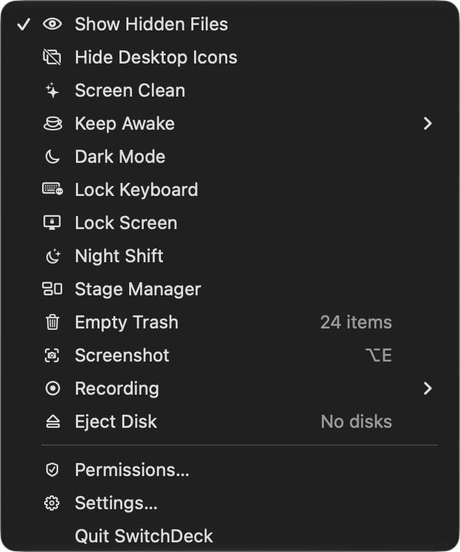
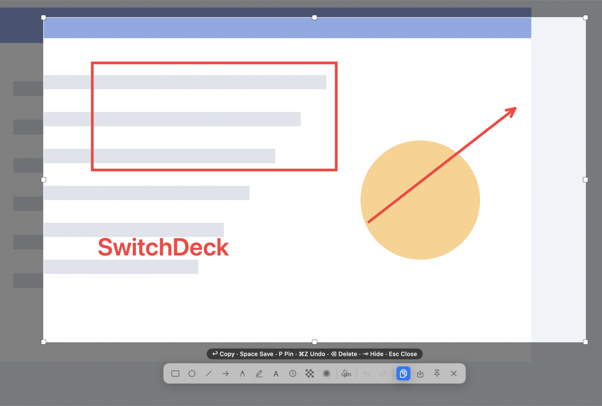

# Panelumi

[English](README.md) · **繁體中文**

[](https://github.com/jwcrystal/panelumi/actions/workflows/ci.yml)
[](https://github.com/jwcrystal/panelumi/releases)
[](#安裝)
[](LICENSE)

平常要翻系統設定、或打開終端機下指令才改得到的 18 個 Mac 設定：顯示隱藏檔、保持清醒、夜覽、深色模式、擦鍵盤用的鍵盤鎖、退出磁碟……全都放在選單列，點一下就切換。另外附一個截圖工具，拍完直接在原地標註，不用再開第二個視窗；也能在本機辨識文字和 QR 碼。

原生 Swift（AppKit + SwiftUI），沒有第三方相依，免費、Apache-2.0 授權。

<p align="center"></p>

## 為什麼用 Panelumi

- **點一下，取代一行終端機指令。** 顯示隱藏檔、隱藏桌面圖示，平常得先 `defaults write …` 再 `killall Finder`；這裡就是選單裡的一列，而且直接顯示目前狀態。
- **一個選單，取代好幾個 App。** 保持清醒、螢幕清潔、快速錄音、能標註的截圖工具都在同一個選單裡，少裝幾個 App，選單列也少幾個圖示。
- **權限只問一次，集中在一個視窗。** 做事做到一半不會突然跳對話框；缺權限的開關只會告訴你缺什麼，不會自己跳出詢問。
- **選單照你的習慣排。** 用不到的開關藏起來，其他的拖曳排序。
- **截圖不用切換 App。** 拖出區域、原地標註，`Enter` 複製、`Space` 存檔。

**狀態：pre-1.0（0.15.0）。** 已可日常使用，介面有英文與繁體中文。設定檔格式在 1.0 之前仍可能調整。

## 安裝

### 從 release 安裝

需要 macOS 14 以上。從 [Releases](https://github.com/jwcrystal/panelumi/releases) 下載 zip，把 `Panelumi.app` 放進 `/Applications`。release 由 CI 建置，用固定的自簽憑證簽章，而不是付費的 Apple Developer ID；也沒有經過 notarize，所以 macOS 會擋第一次啟動：

1. 點兩下開啟，警告視窗按 **Done**。
2. 打開系統設定 › 隱私權與安全性，捲到「安全性」，按 **仍要打開**，然後驗證身份。
3. 再啟動一次。之後就會正常開啟。

也可以在終端機執行 `xattr -dr com.apple.quarantine /Applications/Panelumi.app`。macOS 15 之後右鍵→打開已經無效。0.9.1 起每個 release 都用同一張憑證簽章，更新後輔助使用、自動化與螢幕錄製權限會保留。從 0.9.0 或更早版本升級，或在 release 與本機建置之間切換時，會再問一次。

想知道有沒有新版，從選單點「檢查更新…」。它會拿目前版本和 GitHub 上最新的 release 比較，有新版就帶你到下載頁；Panelumi 不會自己在背景檢查。選單在「檢查更新…」下面直接顯示目前版本，不用開設定。

### 從原始碼建置

需要 macOS 14 以上，以及 Xcode 命令列工具（`swift --version` 應顯示 5.9 以上）。

```bash
git clone https://github.com/jwcrystal/panelumi.git && cd panelumi
swift test                      # 159 個測試，不需要 UI
./scripts/build-app.sh          # 產出 build/Panelumi.app
open build/Panelumi.app
```

`./scripts/setup-signing.sh` 可選，但每台機器值得跑一次：它會建立本機信任的自簽憑證 `Panelumi Local Signing`，`build-app.sh` 之後就自動用它簽章。沒有它，每次重建都會換一個 ad-hoc CDHash，macOS 會把每次建置當成新 app，於是輔助使用與自動化權限每次都要重新詢問。

開機自動啟動需要把 app 放進 `/Applications`；在那之前，設定 › 一般裡的開關會顯示系統錯誤。

## 開關

| 開關 | 做什麼 | 需要權限 |
|---|---|---|
| 顯示隱藏檔 | 在 Finder 顯示點開頭的檔案與隱藏資料夾（Finder 會重啟） | |
| 隱藏桌面圖示 | 分享螢幕或截圖前把桌面清乾淨（Finder 會重啟） | |
| 自動隱藏 Dock | 平常把 Dock 收起來，游標移到螢幕邊緣才出現（Dock 會重啟） | |
| 螢幕清潔 | 所有螢幕變黑並鎖住鍵盤，方便擦螢幕和鍵盤 | 輔助使用 |
| 保持清醒 | 讓 Mac 不進入睡眠，可不限時或設定時長；勾選「螢幕保持開啟」連螢幕也不會關 | |
| 深色模式 | 切換系統外觀 | 自動化 |
| 靜音 | 把目前的輸出裝置靜音，不動音量 | |
| 麥克風靜音 | 把目前的輸入裝置靜音；裝置不支援靜音時，選單顯示「無法使用」 | |
| 鎖定鍵盤 | 清潔時忽略按鍵；5 分鐘後自動解鎖 | 輔助使用 |
| 鎖定螢幕 | 立刻鎖定螢幕 | |
| 夜覽（Night Shift） | 開關夜覽 | |
| 幕前調度 | 開關幕前調度 | |
| 幕前調度自動隱藏 | 隱藏幕前調度的側邊列 | |
| 清空垃圾桶 | 清空垃圾桶；選單顯示裡面有幾個項目 | 自動化 |
| 清空剪貼簿 | 清掉剪貼簿內容 | |
| 錄音 | 用選定的麥克風錄音；選單顯示已錄時間 | 麥克風 |
| 截圖 | 區域、視窗、多視窗合成與全螢幕擷取，附就地編輯器（[見下](#截圖編輯器)） | 螢幕錄製 |
| 文字辨識 | 框選範圍或視窗，在本機辨識其中的文字或 QR 碼；預設開結果視窗可修改後複製，開啟靜默辨識則直接複製 | 螢幕錄製 |
| 結束所有 App | 結束 Finder 以外的所有 App；未儲存的工作仍會跳出詢問 | |
| 退出磁碟 | 退出所有可卸除的卷宗 | |

每個開關的實作方式列在[開發](#每個開關怎麼實作)一節。

設定 › 自訂可以調整順序與隱藏開關，選擇存在 `~/Library/Application Support/Panelumi/config.json`。列可以拖曳排序；右鍵選單提供「上移／下移／在選單中顯示」給鍵盤操作。

設定 › 截圖放擷取的選項；設定 › 文字辨識放快速鍵、靜默辨識與自動複製；設定 › 錄音則集中處理音訊。

設定 › 錄音決定資料夾與麥克風。`AVAudioRecorder` 只能從 macOS 預設輸入錄音，所以選定的麥克風會在錄音期間成為預設，停止或結束 App 時再還原上一個裝置。

## 截圖編輯器

<p align="center"></p>

- `⌥E` 擷取（在設定 › 截圖可改）。拖出區域，或點視窗只拍那個視窗（`⇧` 點多個合成一張，再按 `Return` 編輯）；`F` 全螢幕，`R` 上次的區域。
- 視窗截圖也包含按下那一刻開著的東西：應用程式的選單、選單列圖示彈出的面板、浮動面板、桌面小工具，以及 Dock。它們在按下瞬間各自抓取，再依實際繪製的範圍裁剪，所以畫在大片透明視窗裡的面板只會留下面板本身。選單列跟以前一樣，要拖出區域。
- 擷取後**就地**編輯：選取範圍留在畫面上、範圍外變暗、工具列在選取區下方，不開第二個視窗。
- 工具：矩形、橢圓、直線、箭頭（直線／曲線／折線）、手繪、螢光筆、文字（可加氣泡）、編號、馬賽克、模糊。游標停在工具上會顯示名稱與快捷字母；選了工具，下方出現樣式列；再點同一個工具（或按 Esc、V）就放下工具。`⇥` 隱藏工具列。
- 沒選工具時點既有標記是改那個物件，樣式列顯示它自己的值；拖曳與八個控制點可移動、縮放，⌫ 刪除選取的標記。
- 顏色來自共用的 10 色色盤，附最近使用與自訂頁（hex 或 RGB），`I` 是滴管；顏色與線寬跨啟動記住。
- 選取時顯示指標下的顏色值與像素座標，`⌥` 切 HEX／RGB／HSL，`C` 複製並離開。
- 按下快速鍵的瞬間整個畫面就凍結，開著的選單和提示都還在畫面裡，馬賽克與模糊也就是存下來的結果。延遲擷取以小膠囊倒數，再按快速鍵取消。
- `Enter` 複製、`Space` 存檔（預設 `~/Downloads`、PNG）、`P` 釘選、`⌘Z`／`⇧⌘Z` 復原與重做標註（樣式列不會跟著回退）、`Esc` 關閉；資料夾、檔名前綴、格式、品質與延遲在設定 › 截圖。
- 簽名按鈕加浮水印（macOS 使用者全名，或設定裡的字），子選單可開關、選位置（或平鋪）、調大小與顏色，裁在範圍內；「更多…」有其餘選項，包括從影像隱藏但文字仍留在檔案中介資料。預設的位置、大小、角度、不透明度與顏色在設定 › 截圖。
- 釘選的圖：× 或 `Esc` 關閉，滾輪縮放，`⌘`+滾輪改不透明度。

## 權限

macOS 的 TCC 無法預先授予。缺少權限時 Panelumi 會顯示「設定 Panelumi」視窗，那個視窗也是 app 唯一會觸發系統權限對話框的地方：

- **自動化 — System Events** — 深色模式。
- **自動化 — Finder** — 清空垃圾桶與項目計數。
- **輔助使用** — 鎖定鍵盤與螢幕清潔。
- **麥克風** — 錄音。
- **螢幕錄製** — 截圖與文字辨識；macOS 會在重新啟動後套用授權。

在那裡授予一次，之後選單不會再問；用到缺權限的開關時只會說明缺什麼。可從選單的「權限…」或設定 › 一般重新打開那個視窗。設定 › 一般也會列出輔助使用與自動化的狀態。

## 開發

```bash
build/Panelumi.app/Contents/MacOS/Panelumi --dump          # 每個開關 + 即時狀態
build/Panelumi.app/Contents/MacOS/Panelumi --run keepAwake # 執行單一開關並印出結果
build/Panelumi.app/Contents/MacOS/Panelumi --hotkeys       # 註冊測試快速鍵，回報衝突
build/Panelumi.app/Contents/MacOS/Panelumi --permissions   # app 看到的每個權限狀態
build/Panelumi.app/Contents/MacOS/Panelumi --menu          # 建出來的選單長怎樣
build/Panelumi.app/Contents/MacOS/Panelumi --capture-test  # 擷取主螢幕並回報結果
build/Panelumi.app/Contents/MacOS/Panelumi --editor-demo   # 用 $PANELUMI_DEMO_IMAGE 當背景開編輯器，供截圖用
build/Panelumi.app/Contents/MacOS/Panelumi --ocr-demo      # 對 $PANELUMI_DEMO_IMAGE 做文字辨識
build/Panelumi.app/Contents/MacOS/Panelumi --audio-inputs  # CoreAudio 看到的麥克風，標出預設
build/Panelumi.app/Contents/MacOS/Panelumi --timed-demo    # 跑一次 3 秒延遲擷取，方便目視檢查
```

```
Sources/PanelumiKit/             # 沒有 AppKit UI，可單元測試
  SwitchItem.swift             # 一列選單：標題、圖示、狀態、動作、子選單
  SwitchCatalog.swift          # 內建開關
  Config.swift                 # 順序、可見性與快速鍵，JSON 持久化
  HotkeyBinding.swift          # 按鍵 + Carbon 修飾鍵 + 鍵帽標籤
  Shell.swift / Automation.swift
  Switches/                    # 一個開關一個檔
Sources/PanelumiCore/        # app 程式碼，包成函式庫：AppKit + SwiftUI
  Launcher.swift               # PanelumiLauncher.run()，唯一公開的進入點
  MenuController.swift         # NSStatusItem + NSMenu，設定變更時重建
  HotkeyCenter.swift           # Carbon 註冊、衝突回報
  HotkeyRecorder.swift         # NSEvent -> binding，本機擷取監聽
  SettingsView.swift           # SwiftUI 設定
  Screenshot/                  # 擷取、就地編輯器、標註
Sources/Panelumi/            # 精簡的執行檔
  main.swift                   # 呼叫 PanelumiLauncher.run()
Tests/PanelumiKitTests/          # 開關、設定、快速鍵、垃圾桶計數
Tests/ScreenshotTests/         # 標註歷史、樣式、擷取與選取
```

### 每個開關怎麼實作

| 開關 | 怎麼實作 | 備註 |
|---|---|---|
| 顯示隱藏檔 | `defaults write com.apple.finder AppleShowAllFiles` + 重啟 Finder | Finder 會重啟 |
| 隱藏桌面圖示 | `defaults write com.apple.finder CreateDesktop` + 重啟 Finder | Finder 會重啟；選單顯示「Icons hidden」 |
| 自動隱藏 Dock | `defaults write com.apple.dock autohide` + `killall Dock` | launchd 會把 Dock 重新啟動 |
| 螢幕清潔 | 每個螢幕覆蓋一層螢幕保護程式層級的黑幕 + 鎖定鍵盤 | 點一下叫出「停止清潔」 |
| 保持清醒 | `ProcessInfo.beginActivity`（勾選「螢幕保持開啟」時加上 `.idleDisplaySleepDisabled`），可選時長，選單顯示到期時間 | 可用 `pmset -g assertions` 查到 |
| 深色模式 | 透過 System Events 改外觀偏好 | 需要自動化權限 |
| 靜音／麥克風靜音 | 對預設輸出或輸入裝置設定 Core Audio 的 `kAudioDevicePropertyMute`，沒有主聲道靜音時改設各聲道 | 不會把音量歸零；裝置不支援靜音時顯示「無法使用」 |
| 鎖定鍵盤 | `CGEventTap` 吞掉按鍵事件，5 分鐘後自動解鎖 | 需要輔助使用權限 |
| 鎖定螢幕 | `login.framework` 的私有 API `SACLockScreenImmediate` | 失敗時退回 System Events 的 ⌃⌘Q |
| 夜覽（Night Shift） | `CoreBrightness` 的私有 API `CBBlueLightClient`（`dlopen`） | 沒有公開 API；已在 macOS 27 驗證 |
| 幕前調度 | `com.apple.WindowManager GloballyEnabled` + 重啟 WindowManager | 鍵名需要在實機目視確認 |
| 幕前調度自動隱藏 | `com.apple.WindowManager AutoHide` + 重啟 | 同上 |
| 清空垃圾桶 | Finder AppleScript：`count items in trash`、`empty trash` | 需要自動化權限；TCC 會擋掉直接讀 `~/.Trash` |
| 清空剪貼簿 | `NSPasteboard.clearContents()` | |
| 錄音 | `AVAudioRecorder` 存到設定 › 錄音選的資料夾（預設 `~/Music/Panelumi`），可選麥克風；選單顯示已錄時間 | 需要麥克風權限 |
| 截圖 | `ScreenCaptureKit` 擷取區域／單一視窗／多視窗合成／全螢幕；無邊框就地編輯器，支援矩形、橢圓、直線、箭頭、畫筆、螢光筆、文字、編號、馬賽克與模糊；延遲擷取、HEX／RGB／HSL 讀值、PNG／JPEG／HEIC 儲存；可複製、儲存、釘選 | 需要螢幕錄製權限 |
| 文字辨識 | 沿用截圖的選取層，選好就結束；Vision `VNRecognizeTextRequest`（精準等級、自動偵測語言，支援繁中、簡中、英、日、韓）與 `VNDetectBarcodesRequest` | 在本機執行；有 QR 碼時優先複製 QR 碼內容 |
| 結束所有 App | `NSRunningApplication.terminate()`，跳過 Finder 與 Panelumi | 未儲存的工作仍會跳出詢問 |
| 退出磁碟 | `NSWorkspace.unmountAndEjectDevice`，計數可卸除的卷宗 | |

新增一個開關就是一個 `SwitchItem` 加一個類別；`docs/adding-a-switch.md` 有完整流程。

簽章在重建之間保持穩定的 designated requirement 是：

```
identifier "io.github.jwcrystal.panelumi" and certificate leaf = H"…"
```

用 `codesign -d -r- build/Panelumi.app` 驗證。

## 不會上 App Store

Panelumi 以現在的形式無法上 Mac App Store，也沒有試：

- 用了私有 API（`SACLockScreenImmediate`、`CBBlueLightClient`），App Review 會直接退。
- 沒有沙盒，透過 Apple Events 驅動 Finder 與 System Events。
- 鎖定鍵盤是吞掉所有按鍵事件的 `CGEventTap`。
- 沒有 App Store 用的識別碼、entitlement 或團隊簽章。
- 私有 API 可能在任一次 macOS 更新後壞掉；壞掉的開關會退化成一句說明而不是 crash，但這個 repo 不承諾別的。

release 會附上 CI 建置的 zip（自簽憑證簽章，未 notarize），第一次啟動需要按「仍要打開」（見[安裝](#從-release-安裝)）。想自己簽章就用原始碼建置；要交給別人則建議用 Developer ID 簽章並 notarize。

## 多語系

介面提供英文與繁體中文（台灣）。原始碼裡的英文字面就是 key，翻譯放在 `Resources/zh-Hant.lproj/Localizable.strings`，`scripts/build-app.sh` 會把每個 `.lproj` 複製進 bundle。`./scripts/check-localizations.sh` 會在 `t()` 的 key 沒有條目、或翻譯漏掉 `%@`／`%d` 佔位符時失敗。沒有對應語言檔就顯示英文。設定 › 一般 › 語言可以覆寫 app 自己的語言（系統、English、繁體中文）；macOS 只在啟動時決定 bundle 的語言，所以切換後會提供重新啟動。

## 設計取向

Panelumi 維持精簡的單層原生選單、不受沙盒限制的本機建置，以及一個開關一個 `SwitchItem`。

## 回饋

錯誤回報、問題與新開關的想法請開 [GitHub Issues](https://github.com/jwcrystal/panelumi/issues)。回報錯誤時請附上 macOS 版本、Panelumi 版本（設定 › 關於），若是某個開關異常，也請附上 `/Applications/Panelumi.app/Contents/MacOS/Panelumi --dump` 與 `--permissions` 的輸出。

## 授權

[Apache License 2.0](LICENSE)。Copyright © 2026 Jared Wang。署名請見 [NOTICE](NOTICE)，品牌使用說明請見 [TRADEMARKS.md](TRADEMARKS.md)。先前以 MIT 授權發布的版本仍依原條款提供。
